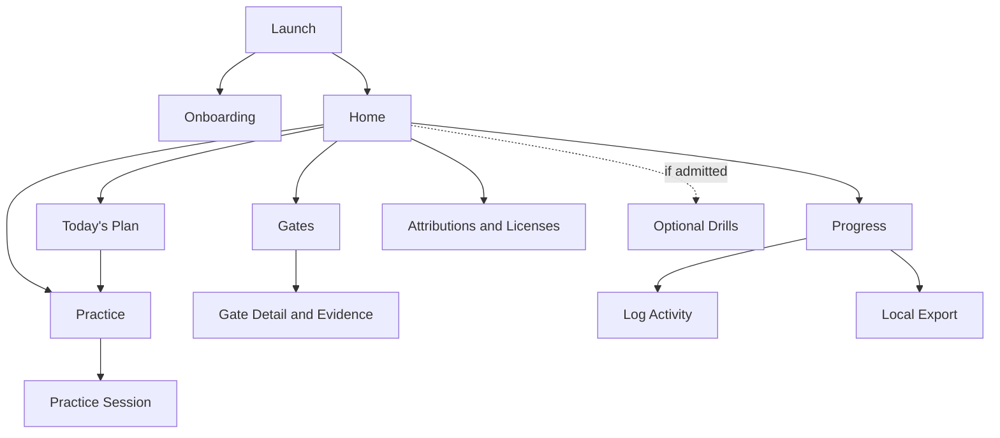

# FUNCTIONAL DESIGN v1.0
## Offline Russian Learning Companion

**Status:** SUPERSEDED historical record. Binding design is `docs/design/PREMIUM_OFFLINE_APP_BLUEPRINT_v2.0.md`.

**Authority:** `MASTER_AUTHORITY_v1.0.md`  
**Scope source:** `PRODUCT_BRIEF_v1.1.md`

## 1. Design Boundary

This design defines only the user-facing behavior required for the four v1 capabilities: daily conductor, listen-record-compare, advancement gates and evidence, and log/review/preserve with local export. It also defines onboarding, content-rights information, and a conditional optional-drills area. It does not add AnkiDroid integration, an SRS, ASR, content generation, proficiency assessment, cloud behavior, or excluded curriculum. *(Trace: MA-001–MA-028, MA-080–MA-116; Product Brief §§1–5, 8–9)*

Where the authorities are silent, this design chooses the smallest usable behavior: one local learner profile, one active course position, fixed shipped plan and gate definitions, manual evidence entry, and user-initiated export. These are design choices, not new product capabilities.

## 2. Complete Navigation Model

### 2.1 Launch and first use

1. **Launch** checks whether required local app data can be read.
2. A first launch opens **Onboarding**.
3. Completed onboarding opens **Home**.
4. A local-data failure opens **Local Data Problem**, from which the user may retry or view content rights.

### 2.2 Home and primary areas

**Home** is the sole top-level hub and exposes:

- **Today's Plan** → activity detail or Listen-Record-Compare;
- **Practice** → Listen-Record-Compare Library → Practice Session;
- **Gates** → Gate Detail → Evidence Entry;
- **Progress** → Log Activity, Progress Review, or Local Export;
- **Attributions & Licenses**;
- **Optional Drills**, only when an admitted curation-only drill package is present.

Every subordinate screen returns to its parent and then Home. No path launches, reads from, or exchanges data with AnkiDroid; AnkiDroid work is represented only as a named external activity and as user self-attestation. *(Trace: MA-043–MA-049, MA-050–MA-067, MA-068–MA-086, MA-087–MA-100; Product Brief §3)*

### 2.3 Navigation map

The diagram is navigational only and does not prescribe implementation.

## 3. Global User-Facing Rules

- All screens and actions remain usable in airplane mode after installation. No screen offers sign-in, cloud sync, streaming, remote search, or online recovery. *(Trace: MA-009–MA-019, MA-110, MA-119; Product Brief §5)*
- Russian displayed by the app is limited to bundled, licensed, already-corrected source material. The interface never offers generation or linguistic validation. *(Trace: MA-020–MA-023, MA-111–MA-113; Product Brief §§6–7, 9)*
- User recordings and evidence are described as user data; activity totals are described as completed work, never as proficiency. *(Trace: MA-101–MA-109; Product Brief §§3.4, 4, 10)*
- Pronunciation practice uses neutral labels such as “recorded,” “played,” and “completed”; it never uses correctness, score, accent, fluency, or pass/fail judgments. *(Trace: MA-024–MA-027, MA-055; Product Brief §§3.2, 4)*
- Book and AnkiDroid evidence is always visibly labeled “Self-attested.” *(Trace: MA-061, MA-063–MA-064; Product Brief §§3.3, 8.2, 8.5)*
- No screen reproduces Penguin lesson text or exercises; course references are limited to lesson identity and directions to use the user's copy. *(Trace: MA-041–MA-042, MA-081; Product Brief §§3.1, 6)*

## 4. Screen Specifications

### 4.1 Launch

**Purpose:** Establish whether the local app state and required bundled content are available, then route to Onboarding or Home. *(Trace: MA-009, MA-018–MA-019, MA-072–MA-073; Product Brief §§5, 10)*

**Contents:** App identity; brief local-loading status; no account, network, update, or synchronization prompt.

**Primary action:** Automatic transition to Onboarding on first use or Home on later use.

**Secondary navigation:** Attributions & Licenses is available if core content cannot be loaded but the rights record remains readable.

**Failure/empty states:**

- If required local data cannot be read, show “Local data could not be opened,” identify whether bundled content or user data is affected without claiming repair, and offer Retry.
- If the content package is absent or corrupt, do not expose incomplete Russian practice.
- If user data is absent on a first launch, treat it as a valid new-user state and open Onboarding.

### 4.2 Onboarding

**Purpose:** Explain the app's limited role, establish the user's current Penguin lesson, and make the first daily plan usable without requiring a tutor or account. *(Trace: MA-001–MA-004, MA-015, MA-028, MA-042, MA-049, MA-058; Product Brief §§1, 3.1, 5)*

**Contents:**

- concise statement that the app coordinates the user's book, AnkiDroid work, listening/recording, gates, and logs;
- explicit statement that the app does not teach from reproduced Penguin content, connect to AnkiDroid, judge Russian, or certify proficiency;
- selection of the current Penguin lesson within the shipped beginner arc;
- explanation that default gates require no tutor and that tutor sign-off can be added later only as user-chosen strictness;
- explanation that all data is local and backup requires user-initiated export.

**Primary action:** Confirm the current lesson and create the initial local plan state.

**Secondary navigation:** Attributions & Licenses; return to the prior onboarding page.

**Failure/empty states:**

- If the user has not selected a lesson, keep confirmation unavailable and explain that a lesson selection is required to create the plan.
- If plan definitions are unavailable or corrupt, show that onboarding cannot finish and offer Retry; do not create an invented plan.
- Tutor absence is never an error or blocker.

### 4.3 Home

**Purpose:** Give immediate access to today's required work and the four primary areas without a separate setup guide. *(Trace: MA-003, MA-043–MA-049, MA-124–MA-137, MA-146–MA-161; Product Brief §§2, 3, 10, 12)*

**Contents:** Current lesson; a prominent Continue card first, showing lesson number, next unfinished required activity, completed versus total required activities, and a single Continue action; appearance control limited to Dark and Follow system; one-line backup, storage-health, and seven/thirty-day study-balance summaries; gate status summary; latest recorded activity labeled as activity; entry points for Today's Plan, Practice, Gates, Progress, and Attributions & Licenses; Optional Drills entry only when admitted content is installed. Detailed backup, health, and category-balance information lives on Progress.

**Primary action:** Continue to the exact destination of the next unfinished required activity, or to the applicable gate, progress, or lesson-start state.

**Secondary navigation:** Open any top-level area.

**Failure/empty states:**

- **No plan loaded:** show a single action to select the current lesson and establish the plan.
- **Plan complete:** show completion and allow Progress review; do not equate completion with proficiency.
- **Bundled practice unavailable:** keep book, AnkiDroid, logging, gates, and export accessible while clearly disabling affected practice.
- **User data unreadable:** show Local Data Problem rather than fabricated totals.

### 4.4 Today's Plan

**Purpose:** Present and record completion of the lesson-aligned daily checklist. *(Trace: MA-043–MA-049, MA-080–MA-084; Product Brief §3.1)*

**Contents:**

- current lesson identifier;
- prescribed book activity stated only as a reference to the user's copy;
- assigned AnkiDroid activity stated as work to perform separately;
- listen-record-compare activity with an in-app start action;
- tutor task only when the user has chosen to include one;
- completion state for each item.

**Primary action:** Open the selected item or mark an external book, AnkiDroid, or tutor activity complete. When opened from Continue, the named Book or AnkiDroid plan item and its completion action are presented first. The plan-definition identity is carried in the route. There is no AnkiDroid integration or in-app practice bank.

**Secondary navigation:** Home; Practice for audio work; Progress for the resulting activity record.

**Failure/empty states:**

- **No plan:** explain that the current lesson must be selected and route to the minimal lesson selection step.
- **No required work today:** state that no work is prescribed; do not generate replacement work.
- **Referenced book/AnkiDroid unavailable to user:** allow the item to remain incomplete; do not substitute app-native material.
- **Save failure:** retain the visible prior completion state, report that the change was not saved, and offer Retry.

### 4.5 Practice Library

**Purpose:** Present the bundled, licensed native audio models available for listen-record-compare practice. *(Trace: MA-023, MA-029–MA-040, MA-050–MA-051; Product Brief §§3.2, 6–7)*

**Contents:** Available models identified by source-supplied stress-marked text and source attribution; completion/recording presence; license/source detail access.

**Primary action:** Open a selected Practice Session.

**Secondary navigation:** Home; Today's Plan; Attributions & Licenses.

**Failure/empty states:**

- **No admitted audio:** state that no licensed practice audio is available and provide no recording-only substitute.
- **Audio file missing or corrupt:** disable that model, identify it as unavailable, and retain access to its provenance record.
- **Text/audio match unavailable:** exclude the asset from practice rather than displaying an unmatched pair.

### 4.6 Practice Session

**Purpose:** Let the user hear a licensed native model, record an imitation locally, replay both, mark the recording for tutor review, and record completion without evaluation. *(Trace: MA-050–MA-055, MA-138–MA-145, MA-158–MA-161; Product Brief §§3.2, 8.3, 12.3)*

**Contents:** Verified source-supplied stress-marked text; native-model playback at 0.75× or 1.0×; local recording control; separate replay of the user recording at 1.0×; automatic model-then-user A/B playback; repeat A/B loop and stop-loop; replace-current-take; clear tutor-review mark; completion state; source and license link; explicit “No pronunciation score is provided” statement. Controls remain distinguishable without color.

**Primary action:** Complete the sequence of model playback, user recording, and A/B replay.

**Secondary navigation:** Previous/next admitted model; Practice Library; Today's Plan.

**Failure/empty states:**

- **Microphone permission unavailable:** explain that recording cannot begin and leave model playback available; do not claim completion of the recording activity.
- **Recording interrupted or storage unavailable:** report that no usable recording was saved and allow a retry.
- **Model audio cannot play:** disable recording against that model because A/B comparison cannot be completed.
- **No user recording yet:** present model playback and a Record action without an empty score or judgment.
- **Corrupt saved recording:** report the recording as unavailable while preserving its log record and allowing replacement.

### 4.7 Gates List

**Purpose:** Show course-segment gates and their recorded status without presenting gate state as proficiency. *(Trace: MA-056–MA-067, MA-101–MA-109; Product Brief §§3.3, 8.5)*

**Contents:** Gate name tied to course sequence; status of evidence collection; satisfied/not-yet-satisfied state; “activity gate, not proficiency certification” label.

**Primary action:** Open Gate Detail.

**Secondary navigation:** Home; Progress.

**Failure/empty states:**

- **No gate for current position:** state that no advancement gate is defined for the selected segment; do not invent criteria.
- **Evidence unavailable:** show the gate as not evaluable and identify the missing recorded evidence.
- **Gate definition unreadable:** show an error and do not issue an advancement decision.

### 4.8 Gate Detail and Evidence

**Purpose:** Display the exact gate rule, collect permitted evidence, and produce a reproducible gate decision. *(Trace: MA-056–MA-067; Product Brief §§3.3, 8.5, 10)*

**Contents:**

- the complete displayed default rule;
- book revision-score entry labeled “Self-attested — not independently verified”;
- AnkiDroid completion or maturity entry labeled “Self-attested — no AnkiDroid integration; not independently verified”;
- completion evidence required by the rule;
- optional user control to add tutor sign-off as stricter evidence;
- recorded evidence values and times;
- resulting satisfied/not-yet-satisfied decision with a visible breakdown of how each rule condition evaluated.

Optional-drill results never appear as eligible evidence.

**Primary action:** Save evidence and recalculate the displayed rule.

**Secondary navigation:** Gates List; related Today's Plan; Progress.

**Failure/empty states:**

- **No evidence entered:** show all rule conditions as awaiting user evidence.
- **Invalid or incomplete entry:** identify the affected field and withhold a decision until the entry is valid.
- **No tutor engaged:** default rule remains satisfiable; tutor evidence remains absent without warning or penalty.
- **Save failure:** preserve the last saved evidence and decision, identify unsaved changes, and offer Retry.
- **Corrupt evidence:** show the affected evidence as unreadable and withhold a satisfied result until corrected.

### 4.9 Progress

**Purpose:** Review accumulated work and skill balance without inferring proficiency. *(Trace: MA-068–MA-071, MA-101–MA-109, MA-146–MA-157; Product Brief §§3.4, 10, 12.4–12.6)*

**Contents:** Cumulative time and completion; category totals for reading, listening, vocabulary/forms, grammar, speaking/pronunciation, writing, and tutor work; compact seven-day and thirty-day factual category views; backup status from local export records; data and storage health; recent logs; explicit label that the view measures recorded activity, not certified ability.

**Primary action:** Open Log Activity.

**Secondary navigation:** Local Export; Home; Gates; individual recent log details.

**Failure/empty states:**

- **No activity:** show zero recorded work and an action to Log Activity; do not infer weakness or proficiency.
- **A category has no activity:** show zero and identify it only as an activity imbalance.
- **Data unreadable:** do not compute totals from partial or corrupt records; show Local Data Problem.

### 4.10 Log Activity

**Purpose:** Record the user's own study time and completion in the governed categories. *(Trace: MA-048, MA-068–MA-069; Product Brief §3.4)*

**Contents:** Activity category; duration; completion state; date/time based on the device's local value; optional association with the current lesson; self-attestation label for book and AnkiDroid entries.

**Primary action:** Save the activity log locally.

**Secondary navigation:** Cancel to Progress; return to Today's Plan when opened from a plan item.

**Failure/empty states:**

- **Missing required values:** identify them and keep Save unavailable.
- **Invalid duration:** request a valid nonnegative duration without inferring performance.
- **Save failure:** retain the unsaved entry on screen and offer Retry.
- **Device time changes:** retain the user-visible recorded local value without consulting a network time source.

### 4.11 Local Export

**Purpose:** Create a user-initiated local backup of governed user data for copying, recovery, or reference after device loss. *(Trace: MA-074–MA-079, MA-120; Product Brief §§3.4, 5, 10–11)*

**Contents:** Export scope listing logs, gate evidence, progress data, and recordings; destination selection through the device's local file interface; export status; clear statement that this is local export, not cloud backup or synchronization.

**Primary action:** Choose a local destination and start export.

**Secondary navigation:** Progress; Home.

**Failure/empty states:**

- **No user data:** allow an export containing valid empty structured datasets and no recordings, clearly identified as empty.
- **Destination unavailable or permission denied:** do not create a partial success claim; allow destination reselection.
- **Insufficient storage:** stop, report failure, and identify any incomplete export as unusable.
- **Individual recording unreadable:** fail the complete export and identify the affected local record rather than silently omitting it.
- **Export interrupted:** report that completion was not confirmed and allow a fresh export.

### 4.12 Attributions & Licenses

**Purpose:** Make the attribution record and content-license inventory readable offline. *(Trace: MA-029–MA-040, MA-121; Product Brief §§5–6, 11)*

**Contents:** Source name; asset or dataset identity; license; attribution text; provenance; modification status; share-alike treatment; audio-specific file identity and license status; access from each practice asset to its associated record.

**Primary action:** Read or inspect a source or asset record.

**Secondary navigation:** Home; return to the originating Practice item.

**Failure/empty states:**

- **No attribution inventory:** identify the installation as not release-ready; do not hide the absence.
- **Asset record missing:** mark the affected asset ineligible for presentation or playback.
- **License unclear or incompatible:** mark the asset excluded and prevent its use.
- **Share-alike confirmation absent for derivative data:** display the unresolved release block in the local release-readiness record.

### 4.13 Optional Drills — Conditional Area

**Admission status:** This screen exists only if a drill package has independently cleared every condition in MA-087–MA-098 and MA-110–MA-116. Its absence is a complete and valid v1 state. *(Trace: MA-087–MA-098, MA-110–MA-116; Product Brief §§3, 7, 9, 11)*

**Purpose:** Present an optional deterministic practice view over already-corrected, properly licensed structured source fields without creating or validating Russian.

**Contents:** Source-derived prompt; source-derived response; source provenance; statement that the drill inherits source errors and does not independently validate the source; optional activity completion record; no gate-evidence control.

**Primary action:** Reveal or submit the deterministic source-derived response and continue to another source-derived item.

**Secondary navigation:** Home; Attributions & Licenses.

**Failure/empty states:**

- **No admitted package:** omit the area and navigation entry entirely.
- **No eligible records:** state that no optional drill content is available; do not generate items.
- **Missing provenance or license:** exclude the affected record.
- **Transformation cannot be reproduced deterministically:** exclude the affected drill.
- **Source error suspected:** preserve source identity and do not present the app as correcting or validating it.

## 5. Complete User Flows

### 5.1 Full lesson cycle

1. The user opens Home and begins Today's Plan.
2. The user performs the referenced book work in the owned book and self-records completion or score.
3. The user performs assigned AnkiDroid work outside the app and self-records completion or maturity status.
4. The user completes Listen-Record-Compare using the bundled model and local recording.
5. The user enters gate evidence and reviews the displayed rule breakdown.
6. The app reports the reproducible gate decision without certifying proficiency.
7. The user reviews recorded progress and skill balance.
8. The user creates a local export containing logs, gate evidence, progress, and recordings.

*(Trace: MA-043–MA-086, MA-101–MA-109, MA-117–MA-122; Product Brief §§3, 10–11)*

### 5.2 Tutor-free default path

The user can complete onboarding, plan work, listen-record-compare, enter book and AnkiDroid self-attestations, satisfy shipped default gates, review progress, and export data without a tutor. Tutor review and tutor sign-off appear only after the user chooses them. *(Trace: MA-004, MA-047, MA-054, MA-058–MA-059, MA-097–MA-098; Product Brief §§1, 3, 7, 8.5)*

## 6. Explicitly Absent User Experiences

The app exposes no sign-in, networking, streaming, cloud synchronization, AnkiDroid connection, deck import, SRS, ASR, transcription, pronunciation score, free-response evaluation, generated Russian, original grammar bank, minimal-pair drill, Penguin text reproduction, post-book curriculum, or proficiency claim. *(Trace: MA-007–MA-017, MA-020–MA-028, MA-041, MA-080–MA-086, MA-099–MA-108; Product Brief §4)*

## 7. Conformance Confirmation

This Functional Design introduces no scope beyond, and contradicts nothing in, `MASTER_AUTHORITY_v1.0.md` and `PRODUCT_BRIEF_v1.1.md`. v1.1 Home, Practice Session, and Progress additions remain subordinate to the four primary capabilities.
